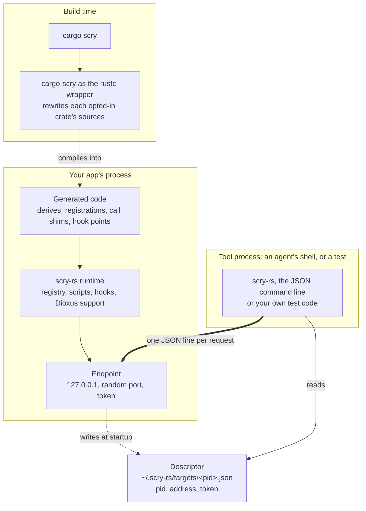

# Scry.Rust


**Scry.Rust gives a running Rust app what the DevTools protocol gives a web page: a live handle on
it from the outside. Read and change its state, call its functions, record and change its calls,
and drive a Dioxus app's pages. AI agents can check their own work against the real app, through
the [agent Skill](skills/scry-rs/SKILL.md) that ships with it, instead of reasoning about what a
change probably did. Tests can reach past the UI into the state behind it. And an app stuck in a
bad state can be examined while it is stuck, instead of restarted in the hope of catching it next
time.**

<br clear="left"/>

Build an app with `cargo scry` instead of `cargo`, and it carries a registry of its own code: every
static, every type, every function, and in a Dioxus app every component's state. The `scry-rs`
command line talks to it while it runs, over a local, token-protected endpoint:

```sh
scry-rs get APP.inventory.items[0]              # read live state, through the app's own locks
scry-rs set APP.rules[0].percent 25             # change it
scry-rs call APP.inventory.total_value_cents    # call the app's own code on the live value
scry-rs hook wait 1 'args.index == 2'           # wait for a call to a function, and see its arguments
scry-rs click text=Add                          # drive a Dioxus app's page, as a user would
scry-rs --out page.png screenshot               # and see it, even with the window minimized
```

**Nothing in the app's source changes.** The app adds an optional dependency to its manifest, and
`cargo scry` generates the rest into a copy of the code at build time. A plain `cargo build` is
unchanged and contains no Scry code at all.

**It is not only for UI apps.** A console app, a service or a background worker gets the same
registry, scripts, calls, hooks, `wait` and `assert`. The Dioxus support adds routes, pages and
screenshots on top.

It runs on Windows, Linux and macOS, with Rust 1.91 or later. Screenshots work on Windows and Linux
so far.

## How an app opts in

Scry.Rust is a build-time opt-in. Nothing is injected into a running process: an app has an endpoint
only when it was built for it. That takes two things.

**The manifest declares an optional dependency and a feature:**

```toml
[features]
scry = ["dep:scry"]

[dependencies]
scry = { package = "scry-rs", version = "0.1", optional = true }
# A Dioxus app adds: features = ["dioxus"]
```

**The app is built with `cargo scry`:**

```sh
cargo install scry-rs-cargo
cargo scry run          # or build, test, clippy, ...
```

`cargo scry` runs the cargo command with `--features scry`, and compiles a rewritten copy of each
opted-in crate instead of the original (see [What gets generated](#what-gets-generated)). The copy
keeps every line where it was, so errors, panics and the debugger still point at the original
files. Builds go to `target/scry`, so the normal build and the Scry build don't rebuild each
other's dependencies.

The registry knows the app's code as written: its statics and their types, its functions, its
Dioxus hooks. So an agent or a test reaches state by the names the code gives it
(`APP.inventory.items[2].qty`), and calls the functions the code defines. Nothing has to be
registered by hand.

## How it gets used

**An AI agent checking its own work.** An agent that just changed code runs the app with
`cargo scry`, then reads the live state back, navigates to the page it changed, checks the text the
page shows and takes a screenshot of it. The workflow is in
[`skills/scry-rs/SKILL.md`](skills/scry-rs/SKILL.md).

**Tests that reach further than UI automation.** UI automation sees only what the page or the
accessibility tree shows. A test with Scry.Rust can click the real buttons *and* assert on the
state behind them, wait for the app to reach a state instead of sleeping, and inject a fault into
one function call to see how the app copes.

**An app stuck in a bad state.** Every so often a long-running app ends up somewhere it shouldn't:
not crashed, not quite working either. A restart clears it, and also loses the state that got it
there. If it runs as a `cargo scry` build, you can read that state directly, call its functions and
watch its calls, before restarting it away.

## It in action

An agent checks a change to the dx-demo's task filter. It starts the app in the background, and
then:

```sh
scry-rs --wait-for-target 5m set FILTER Done   # once the app is up, the filter the toolbar sets
scry-rs text ul                           # what the page lists now
scry-rs get ui.App.board.tasks 2          # the state behind it
scry-rs --out filtered.png screenshot ul  # and what it looks like
scry-rs set FILTER All                    # put it back
```

Each command prints one line of JSON. `text ul` answers `{"ok": true, "result": "Install Rust (High)"}`,
and the screenshot:

```json
{"ok": true, "result": {"element": {"tag": "ul", "id": null, "text": "Install Rust (High)"}, "file": "C:\work\filtered.png", "format": "png", "width": 1492, "height": 21, "bytes": 1503}}
```

A failure has the same shape, with a stable code: `{"ok": false, "error": {"code": "not_writable",
"message": "..."}}`. The exit code is 0 when `ok` is true.

## Getting started

### For AI agents

1. **Install the Skill in your agent.** Claude Code, GitHub Copilot, OpenAI Codex, Cursor and other
   agents can install it themselves. Prompt the agent with:

   > *"Globally install or update the SKILL from: https://github.com/sdaliyot/Scry.Rust/blob/main/skills/scry-rs/SKILL.md"*

   Send the same prompt again later to update it.

   There is nothing to download by hand. The Skill's resolver downloads the `scry-rs` build for your
   platform from the [latest release](https://github.com/sdaliyot/Scry.Rust/releases/latest) the
   first time it is needed, checks it against the release's checksums, and updates it when a newer
   release comes out. See "Locating the `scry-rs` command line" in the
   [Skill](skills/scry-rs/SKILL.md).

   *Unsigned binaries:* what the Skill downloads isn't marked as coming from the internet, so
   SmartScreen and Gatekeeper don't block it, but antivirus software may warn the first time
   `scry-rs` runs.

2. **Ask for a check against the running app.** For example:

   > *"I changed how the cart applies discounts. Run the app with cargo scry, add two items to the
   > cart, and check that the total the page shows and the cart's state both reflect the 15%
   > discount."*

   The agent asks before it adds the `scry` feature to your manifest or installs `cargo scry`.

#### Manual install

To run `scry-rs` yourself, or pin a version in CI:

1. Download the archive for your platform from the
   [latest release](https://github.com/sdaliyot/Scry.Rust/releases/latest):

   | Platform | Archive |
   |---|---|
   | Windows x64 / Arm64 | `scry-rs-x86_64-pc-windows-msvc.zip` / `scry-rs-aarch64-pc-windows-msvc.zip` |
   | Linux x64 / Arm64 | `scry-rs-x86_64-unknown-linux-gnu.tar.gz` / `scry-rs-aarch64-unknown-linux-gnu.tar.gz` |
   | macOS Intel / Apple silicon | `scry-rs-x86_64-apple-darwin.tar.gz` / `scry-rs-aarch64-apple-darwin.tar.gz` |

   `SHA256SUMS` in the same release lists each archive's checksum.
2. Put `scry-rs` on your `PATH`, or set `SCRY_RS_HOME` to its folder. The Skill uses
   `SCRY_RS_HOME` when it is set, and never downloads over it.
3. If you downloaded the archive with a browser, clear the mark it gets, since `scry-rs` is
   unsigned:
   - **Windows:** the archive carries the Mark of the Web, which extracting it passes on to
     `scry-rs.exe`, so SmartScreen may block it. Run `Unblock-File` on the archive before extracting,
     or on `scry-rs.exe` after.
   - **macOS:** the archive is quarantined, and Gatekeeper refuses to run `scry-rs` ("cannot be
     opened because the developer cannot be verified"). Run `xattr -d com.apple.quarantine scry-rs`.

   Downloads made with `curl`, `Invoke-WebRequest` or the Skill get no such mark.

`scry-rs` can also be built from source: `cargo install --git https://github.com/sdaliyot/Scry.Rust scry-rs-cli`.

### For your app

Add the optional dependency and feature shown in [How an app opts in](#how-an-app-opts-in), install
`cargo scry` with `cargo install scry-rs-cargo`, and build or run with `cargo scry`. A Dioxus app
that the `dx` CLI builds uses `cargo scry dx` (see [Apps built with `dx`](#apps-built-with-dx)).

### For automated tests

A test drives a `cargo scry` build of the app the same way an agent does:

- **Through the command line.** Run `scry-rs` and parse its one line of JSON. Pick the app with
  `--pid` when a test starts several. Give the first command `--wait-for-target` (such as
  `--wait-for-target 2m`), so it waits for the app the test just started instead of failing
  with `no_target`.
- **Through the protocol.** The endpoint speaks one JSON object per line over TCP on `127.0.0.1`:
  `{"token": "...", "command": "get APP.stats"}` in, `{"ok": true, "result": ...}` out. The command
  is exactly what follows `scry-rs` on the command line. The app's descriptor, in
  `~/.scry-rs/targets/<pid>.json`, gives its `address` and `token`.

`wait` and `assert` are made for tests: gate on a state instead of sleeping, and fail with
`assertion_failed` when a condition doesn't hold.

## Architecture



| Component | Runs in | What it does |
|---|---|---|
| [`scry-rs-cargo`](scry/crates/scry-rs-cargo) (`cargo scry`) | your build | Runs cargo with `--features scry` and itself as the rustc wrapper, and compiles a rewritten copy of each opted-in crate |
| [`scry-rs`](scry/crates/scry-rs) | your app | The runtime: the `Reflect` trait, the registry, paths, scripts, calls, hooks, the Dioxus support and the endpoint |
| [`scry-rs-derive`](scry/crates/scry-rs-derive) | your build | `#[derive(Reflect)]`, which the generated code puts on every type |
| [`scry-rs-cli`](scry/crates/scry-rs-cli) (`scry-rs`) | your shell | The command line: finds running apps through their descriptors and sends them commands |

The protocol is strictly request and response: the app never sends anything first. Even
`hook wait` and `wait` are answered late rather than pushed.

Commands run on the registry's thread, which in a Dioxus app is the UI thread, so they see the
state exactly as the app's own code does. Waiting (`wait`, `hook wait`) happens on the endpoint's
connection thread instead, so a long wait never holds the UI.

See [`docs/development.md`](docs/development.md) for how the pieces work inside.

## Apps built with `dx`

A Dioxus app that loads files with `asset!()` (stylesheets, icons, scripts) has to be built by the
Dioxus CLI: only `dx` bundles those files and fills in their URLs. Built with plain cargo, the app
starts but its assets come back 404, so it shows unstyled. For these apps, put `dx` after `cargo scry`:

```sh
cargo scry dx build --platform desktop --features desktop
cargo scry dx serve --platform desktop      # likewise for serve, bundle, ...
```

This runs `dx` with `--features scry` and the serde features described under "Third-party types".
The output goes where `dx` puts it, under `target/scry/dx/...` instead of `target/dx/...`.
`dx` takes the rustc wrapper slot for itself and then runs `rustc` by name. So `cargo scry dx` puts
a copy of `cargo-scry` named `rustc` first on the `PATH` it passes to `dx`. The copy is kept under
the system temp folder, in a `scry-rustc` folder, one copy per build of `cargo-scry`. Only the crates
`dx` hands on reach the copy. These are the workspace crates. Dependencies, build scripts and
cargo's own probes get the real `rustc` through `RUSTC`. Hot patching (`dx serve --hot-patch`)
compiles patches with its own rustc call, and these patches get no Scry code.


## Trying it

The repository has two demo apps: `console-demo`, a console app with shared state, third-party types
and generic functions, and `dx-demo`, a Dioxus desktop app with a router, several windows and
error boundaries. From a clone:

```sh
cargo install --path scry/crates/scry-rs-cargo
cargo install --path scry/crates/scry-rs-cli
cd demos
cargo scry run -p console-demo
```

In another terminal:

```sh
scry-rs list
scry-rs roots
scry-rs get APP.stats
scry-rs set APP.rules[0].percent 50
scry-rs set DISCOUNTS_ENABLED false
```

`cargo scry run -p dx-demo` starts the Dioxus demo. Its component state is under `ui`
(`scry-rs get ui`, `scry-rs set ui.App.uptime 1000`), and its filter is the global `FILTER`
(`scry-rs set FILTER Done`).

## Dioxus apps

A Dioxus app's component state is under `ui`, as `ui.<Component>.<binding>`: the results of
`use_signal`, `use_signal_sync`, `use_context_provider`, `use_root_context`, `use_memo`,
`use_resource` and `use_action`. A `GlobalSignal` static is a root of its own, like any static.
With the `dioxus` feature (`features = ["dioxus"]` on the dependency), the endpoint also reaches the
app's router, its page and its windows.

### Pages (the Dioxus router)

In an app with a Dioxus router, `ui` also has the router's state:

```sh
scry-rs get ui.route                 # the current route, as its URL: "/tasks/3"
scry-rs get ui.routes                # the patterns the app declares: ["/", "/tasks/:id", "/about"]
scry-rs set ui.route '"/about"'      # navigate, as a Link would; Back returns to the previous page
scry-rs get ui.can_go_back           # whether there is a previous page (ui.can_go_forward: a next one)
scry-rs call ui::back                # the previous page, as the Back button would; ui::forward likewise
```

Setting `ui.route` checks the URL against the declared patterns first, and refuses one that matches
none of them. Whether a dynamic segment parses (`:id` as a number) is up to the app's route type,
which shows its own error page when it doesn't. Scripts read and set it the same way (`ui.route = "/"`),
and call `back()` and `forward()` (or `invoke("ui::back")` when the app has its own `back`). Both return
the route they land on, and fail when there is nowhere to go.
Scry learns the routes from the router at runtime, through Dioxus's type-erased router handle, so it
works with any `#[derive(Routable)]` type. Nested route types (`#[child("/settings")] Settings { child:
SettingsRoute }`) are part of it: `ui.routes` lists their routes in full (`/settings/theme/:name`),
and `ui.route` checks against them. A second `Router` component placed inside a page has routes of
its own that Scry doesn't see; its pages are still reachable through `click`. `cargo scry` turns
this on (`scry-rs`'s `dioxus-router` feature) for an app that depends on `dioxus-router`, directly or
through `dioxus`'s `router` feature. Each window has its own router; see "Several windows".

### Clicking, typing and reading the page

Event handlers are closures inside the rendered tree, which the registry can't reach. A Dioxus app
with a webview can be driven through its page instead, where the app's own handlers run just as
they do for a user:

```sh
scry-rs click text=Add                       # the innermost visible element showing "Add", in any case
scry-rs click "li:nth-child(2) input"        # or any CSS selector; the first visible match
scry-rs type "input[name=title]" Buy milk    # sets the value and fires input and change
scry-rs text                                 # the page's visible text; `text <selector>` for one element
scry-rs js "return document.title"           # any JavaScript, run as an async function's body
```

`click` and `type` return the element they acted on (`{tag, id, text}`, or `checked` for a
checkbox). The app's handler runs just after the reply, so check its effect with `wait` rather
than an immediate `get`. A selector or text with leading quotes is read as a JSON string (`type "#a b" "  x"`).
An error the page throws comes back as `script_error` with its message, and a page that doesn't
answer within 8 seconds as `timeout`. Elements that are hidden, or parked beside the window as
Dioxus's dev-build toast is, don't match and are left out of `text`. These commands are answered
asynchronously on the UI thread, so the app keeps handling events while one waits. They aren't
available inside `eval` scripts.

### Screenshots

`screenshot` returns what a Dioxus desktop window shows, as a PNG: the visible page, or one
element, named by a selector as for `click`.

```sh
scry-rs --out page.png screenshot                    # the window's viewport
scry-rs --out list.png screenshot ul                 # one element, at its own size
scry-rs --out row.png screenshot "text=Build the demos"
scry-rs --out notes.png window 1 screenshot          # another window
```

The reply is `{format: "png", width, height, base64Data}`, plus `element` for a selector. `--out`
writes the image to a file and replies with its path (`file`) instead of the data.

Nothing is read off the screen. The webview's engine renders the page for the capture: on
Windows through the DevTools protocol's `Page.captureScreenshot` in WebView2, on Linux through
WebKitGTK's snapshot of the document. Windows over the app and the window's place on the desktop
don't change the result, and on Linux a virtual display such as Xvfb is enough.
- **Minimized windows:** on Windows, a minimized window works too. Chromium stops drawing a
  minimized window's page, so Scry briefly hides and shows the webview again to get a fresh frame.
  The page sees `visibilitychange` events when that happens. On Linux, a Dioxus app pauses while
  its window is minimized or hidden (see [Known limits](#known-limits)), so restore it first.
- **Elements past the window's edge:** an element is first scrolled into view within its scrolling
  containers, as for `click`. One larger than the window is rendered in full beyond it.

`cargo scry` turns this on (`scry-rs`'s `dioxus-desktop` feature) for an app that depends on
`dioxus-desktop`. It works on Windows and Linux so far. macOS (WKWebView) has a snapshot API of
its own that isn't wired up yet.

### Errors on the page

A component error - a route that doesn't parse (`/tasks/abc` for `/tasks/:id` with a number), an
event handler that returns `Err` - goes to the nearest error boundary, which shows it in place of its
children until it is cleared. `ui.errors` lists what the window's boundaries are showing:

```sh
scry-rs set ui.route '"/tasks/abc"'          # accepted: it fits /tasks/:id; whether :id parses is the app's call
scry-rs get ui.errors                        # ["Failed to parse route ..."]
scry-rs set ui.route '"/"'                   # somewhere that renders, then
scry-rs call ui::clear_errors                # clears the boundaries, which render their children again
```

Scry sees the root boundary every virtual dom has, and each `ErrorBoundary` a tracked component
renders under; one that holds an error stays listed after the components under it unmount. The
endpoint keeps running while the root boundary shows an error, which unmounts the app's root
component.

### Resources and actions

`use_resource` and `use_action` handles are tracked like signals, read-only, with the operations the
app's own code would call on them:

```sh
scry-rs get ui.About.stats                   # {state: "Ready", value: ...}; state is Pending, Ready, Paused or Stopped
scry-rs call ui.About.stats.restart          # runs the future again; also cancel, pause, resume, clear
scry-rs get ui.About.clear_done              # {pending: false, value: 1}, or value {error: ...} after a failure
scry-rs call ui.About.clear_done.call        # runs an action whose closure takes no arguments
scry-rs call ui.About.clear_done.reset       # forgets the last value; cancel stops a run in progress
```

`ls` lists these under `methods`. In a script they are methods too (`ui.About.stats.restart()`),
except `call`, which a script runs as `ui.About.clear_done.invoke("call")`. A `call` only starts the
action; read `pending` and `value` to see it finish. An action that takes arguments can't be run
from Scry. `use_server_future(...)?` isn't tracked: until it resolves it holds no handle.

### Several windows

A Dioxus desktop app can open more windows (`window().new_window(VirtualDom::new(Notes), cfg)`),
each with a virtual dom, state and router of its own. Scry numbers them in the order it first sees
a component of theirs keep state, starting from 0, the window that runs the endpoint:

```sh
scry-rs windows                                  # [{window: 0, components: [App], route: "/about"}, {window: 1, components: [Notes]}]
scry-rs window 1 get ui                          # any command, run in window 1: its ui, its route
scry-rs window 1 type textarea "Hello"           # its page
scry-rs window 1 eval "ui.Notes.note.len()"
```

Without `window <n>`, a command runs in window 0, as before. A closed window leaves the list, and
the windows after it move up a number; check `windows` again after closing one.

## Scripts

`scry-rs eval <script>` runs a [Rhai](https://rhai.rs) script in the app (`scry-rs eval --file x.rhai`, or
`scry-rs eval -` for stdin). Roots are variables, members are reached as in Rust, and assignments write
through the same rules as `set`:

```rhai
for rule in APP.rules { print(rule.type_name()); }
APP.rules[0].percent = 25;
APP.stats.ticks += 1000;
if FILTER == "All" { FILTER = "Done"; }
#{ items: APP.inventory.items.len(), first: APP.inventory.items[0].name }
```

The reply's `result` is the script's last value as JSON, and `output` holds what it printed.

- A value with members (a struct, a list, a map) reads as a live handle that is re-read on every
  access.
- Everything else reads as a plain copy.
- Handles also have methods: `get()` / `get(depth)` for a snapshot, plus `set(v)`, `len()`,
  `members()`, `children()`, `type_name()`, `kind()` and `path()`.
- A root without members, such as `FILTER`, is a plain variable. It is written back when the script
  ends without an error.

A script runs on the registry's thread, which is the UI thread in a Dioxus app. It is stopped after
5 seconds, can't load modules, and has bounded string, array and map sizes. Scripting comes from
`scry-rs`'s default `script` feature.

## Waiting and asserting

`wait` and `assert` check a Rhai condition against the app's state. A test or an agent can gate on
the app reaching a state, or fail when it hasn't:

```sh
scry-rs wait timeout=15 'APP.stats.sold >= 10'        # {"satisfied": true, "attempts": 26, "elapsedMs": 2750}
scry-rs wait timeout=1 'APP.inventory.len() == 99'    # {"satisfied": false, "lastValue": false, ...}
scry-rs assert 'FILTER == "All"'                      # fails with assertion_failed when it doesn't hold
```

- **`wait`** evaluates the condition every `interval` (100 ms by default) until it gives `true`, or
  `timeout` passes (10 s by default, at most 5 min).
- **A timeout is not an error.** The reply says `satisfied: false` with the last value or error, so
  read the flag rather than the exit code.
- **Errors while waiting count as "not yet".** That covers a path that doesn't exist yet or a busy
  lock.
- **`assert`** evaluates once.
- **A condition that doesn't compile** fails at once, for both.
- **The UI isn't blocked.** Through the endpoint, each evaluation is one short trip to the registry
  thread, and the waiting happens elsewhere, so a long wait never holds a Dioxus app's UI thread.

`wait` runs inside the app, so it needs the app running. To wait for the app itself to start, put
`--wait-for-target DURATION` before any command: `scry-rs` then waits up to that long (`500ms`,
`30s`, `2m`; a bare number is seconds) for a matching app to start, instead of failing with
`no_target` at once. An app is listed only once it can answer: a Dioxus app once its window is up,
which can take a while after the process starts. With `--pid` or `--process`, it waits for that
app:

```sh
scry-rs --process my-app --wait-for-target 2m wait timeout=30 'APP.ready'
```

## Calling app code

`cargo scry` also makes the app's functions and methods callable, with no attributes needed:

```sh
scry-rs fns inventory                          # callable functions, filtered by path
scry-rs ls APP.inventory                       # members, and the methods of the value there
scry-rs call APP.inventory.total_value_cents   # a method on the live value
scry-rs call util::format_cents 12345          # a free function; arguments are JSON values
scry-rs call Discount::new '"promo"' 15        # an associated function (a constructor)
```

In scripts, methods use method syntax and free functions are called by name when the name is
unique. `invoke("path", [args])` reaches any of them:

```rhai
let inv = APP.inventory;
inv.add("Gizmo", 1999, 3, "Misc");          // &mut self, behind the app's RwLock
APP.rules[0].apply(1000, inv.items[0])      // a trait method through Box<dyn PriceRule>
format_cents(inv.total_value_cents())
```

- A method runs on the live value at that path while the app's locks on the way are held. A
  `&mut self` method needs a lock, atomic or signal on its path, like a write.
- A `self` method runs on a clone, so it needs `Clone`.
- Arguments are built from JSON in the shapes `get` returns. Passing a node passes a copy of its
  value.
- Results come back as snapshots. A panic is caught and reported as `panicked`.

Callable means:
- module-level functions, and methods and associated functions of module-level `impl` blocks
  (inherent or trait)
- not generic, or generic and called by the crate with concrete types (see below)
- not `unsafe`: a call can't uphold what the caller of one must
- not `main`, a test or a UI component

Some parameters and functions are handled specially:
- **`&mut` parameters:** the argument is built from JSON (a `Vec` for `&mut [T]`, a `String` for
  `&mut str`) and lent to the call. The reply then also holds the values it was left with:
  `scry-rs call clamp_all::<i64> [5,-3,2000000] 1 1000000` gives
  `{"result": null, "args": {"values": [5, 1, 1000000]}}`.
- **`impl Trait` parameters:** a type is picked when it's sure to meet the bounds:
  - `impl Into<T>` and `impl Borrow<T>` take a `T`
  - `impl AsRef<str>`, `impl ToString` and `impl Display` take a `String`
  - `impl AsRef<Path>` takes a `PathBuf`
  - `impl IntoIterator<Item = T>` and `impl Iterator<Item = T>` take a list

  `Send`, `Sync` and lifetimes may come along. Any other bound, and every closure (`impl Fn`),
  leaves the function uncallable.
- **`&'static` parameters** (`&'static str`, `&'static Config`): the argument is built from JSON
  and leaked, since nothing shorter-lived can be passed. Each call leaks one value; nothing is
  leaked until such a function is called.
- **References to borrowing types** (`&[&str]`, `&Cert<'_>`): a value that holds borrows can't be
  built from JSON. Such a function still compiles and is listed, but calling it fails with
  `cannot_convert`. Likewise, a struct or enum with a field like `label: &'static str` is read
  normally, but building a whole one from JSON fails with `cannot_convert`. Its unit variants can
  still be assigned (`set tab.route "Home"`), including empty ones such as `Home {}` and `Blank()`.
- **`async fn`, or one returning `impl Future`:** it runs to completion on the registry's thread.
  In a tokio app it runs inside the app's own runtime, which the endpoint picks up at the top of
  `main` (`#[tokio::main]` included), so timers, I/O and `spawn` work. A call still running after
  8 seconds is cancelled with `timeout`, before the endpoint's 10-second wait for the registry
  would give up with `target_busy`. In a Dioxus app that thread is the UI thread: the UI
  waits, and a future that waits on the UI only ends in that timeout. A runtime the app builds by
  hand after `main` starts isn't found, and a future that needs it panics.

**Attribute macros.** A function under an attribute macro is skipped, because the macro may rewrite
it. The exceptions are macros known to keep the function callable as written: `tracing`'s
`instrument`, `async_trait`, `cached`/`once`/`io_cached`, `memoize`, `logfn`, `trace` and
`tauri::command`. A crate can vouch for others. They then get call shims and hook points:

```toml
[package.metadata.scry]                 # or [workspace.metadata.scry]; the lists are combined
transparent-attributes = ["my_retry", "metrics::timed"]   # an attribute's last segment or full path
```

If a listed macro does rewrite the body, the build falls back as described under hooks below.
`scry-report.txt` lists every skipped function and why.

Scripts call a value's methods with method syntax. When the type has its own method with the same
name and argument count as one of a node's methods (`Cache::get(key)`, `Inventory::len()`), the
app's method wins. `get(node.path())` still takes a snapshot.

### Generic functions and types

A generic function or impl gets one shim for each set of concrete types the crate itself calls it
with. To find those, `cargo scry` has rustc compile the crate once more to MIR only (the stable
`--emit=mir`) and reads the calls from it:

```sh
scry-rs fns describe                           # util::describe::<Item>, util::describe::<Stats>
scry-rs call ratio 1 4                         # the only instantiation answers to the plain name
scry-rs eval 'APP.labels.get(999)'             # Cache<u32, String>::get on the live cache
```

- An instantiation is listed with its type arguments, such as `describe::<Item>`. When there are
  several, call it by that path.
- Only calls count, because a call proves the types meet the function's bounds. For a generic
  `impl`, a call to any of its methods covers the whole block, except methods with `where` bounds
  of their own.
- Each instantiation's type arguments must be nameable from the function's module: a crate type
  visible there, a std type, or a primitive. Closures, and types private to another module, drop
  that instantiation.
- The extra MIR pass runs only for crates that have generic items. The calls it finds are saved in
  `target/scry/<profile>/scry-src/<crate>.generics`, and the next build reuses them unless the
  compilation changed or an item that defines or mentions a generic function or type changed.
  Mentions include calls to methods of generic types. So after most edits the pass is skipped.
  Comments and formatting never count.
- The reuse can miss one kind of edit. Say an edit changes which type an unchanged call is
  inferred with, through a field or return type that names no generic. Then the old
  instantiation is kept and the new one shows up after the next MIR pass. If a reused
  instantiation no longer compiles, the build runs the MIR pass again before falling back.
- In a large crate the pass costs as much as a check build. To skip it, and the shims of generic
  functions and types with it:

  ```toml
  [package.metadata.scry.generics]   # or [workspace.metadata.scry.generics] for every crate
  enabled = false                    # default true
  ```

## Hooking calls

Every hookable function in a `cargo scry` build has a hook point compiled in. `scry-rs hook add` turns
on recording for one function: each call's arguments, result or panic, duration and thread.

```sh
scry-rs hooks inventory                                   # hookable functions, and which are hooked
scry-rs hook add Inventory::sell_one self=true            # returns {"hook": 1, ...}
scry-rs hook wait 1 timeout=60 'result != () && args.index == 2'
scry-rs hook read 1                                       # every recorded call, with a cursor for the next read
scry-rs hook remove 1
```

- **Snapshots:** arguments and results are snapshots taken during the call, `depth=2` levels deep by
  default, with `self` when `self=true`. A buffer keeps the last `capacity=1000` calls.
- **Panics and async:** a panic is recorded with its message and then continues as before. An
  `async fn` is recorded when its work completes.
- **Waiting:** `hook wait` takes `key=value` options, then an optional Rhai predicate over `args`,
  `result`, `panic`, `instance` (the captured `self`), `seq`, `duration_micros` and `thread`. It
  waits on the endpoint's connection thread, so a long wait never holds a Dioxus app's UI thread.
- **Scripts** can use `hook_add`, `hook_read` and `hook_remove`.
- **Expiry:** a hook expires after `ttl=30m` without a `read` or `wait`.
- **Cost:** while no hook is on a function, its hook point costs one atomic load per call. That was
  below what a release-build benchmark could measure.
- **Capturing never disturbs the function.** A busy lock shows as `<locked: ...>` rather than being
  waited for, a failed capture is only counted, and calls made while capturing aren't recorded.

### Changing calls

A hook can also change the calls it sees. Use this for fault injection ("make the next sale fail"),
for stubbing a slow dependency, or for steering the app into a state that's hard to reach:

```sh
scry-rs hook before 1 'if args.index == 0 { #{ args: #{ index: 4 } } }'   # change an argument
scry-rs hook before 2 '#{ result: () }'                                    # skip the body, return ()
scry-rs hook after 3 'if args.id == 7 { #{ result: #{ Err: "injected" } } }'   # replace the result
scry-rs hook before 1                                                      # an empty script removes it
```

- **When scripts run:** a `before` script runs on the calling thread before the body, with `args`
  and `instance`. It returns `()` for no change, or a map with `args`, `instance` (the `&mut self`
  receiver) or `result`; a `result` skips the body and is returned instead. An `after` script also
  sees `result`, and can return `#{ result: v }` to replace it.
- **What can change:**
  - By-value and `&mut` arguments, and a `&mut self` receiver, are written the way `set` writes:
    a struct takes the fields to change.
  - `&T` arguments can't be changed. Writing through a shared reference would be undefined
    behaviour.
  - A result is built from JSON when its type allows (`{"Ok": ..}`/`{"Err": ..}` for a `Result`).
    Otherwise it's written into the real result.
- **Records:** each changed call is recorded with `changes`, and `skipped: true` when the body was
  skipped.
- **Failures:** a change that fails (a type mismatch, or a script error or panic) leaves the call as
  it was. It is recorded in `changeErrors` and counted in `changeFailures`.
- **Limits:** scripts stop after 100,000 operations, because the app's own thread waits for them.
  They're compiled once per thread, so the first changed call on a thread takes a few
  milliseconds.
- **Marking:** a hook with change scripts is marked `intervenes` in `hooks`, and its summary shows
  the scripts. Treat it like `set`: it changes the app.

Hooks are on by default. A crate can turn them off, or exclude hot or sensitive functions, in its
`Cargo.toml` (`[workspace.metadata.scry.hooks]` sets the same keys for a whole workspace):

```toml
[package.metadata.scry.hooks]
enabled = true                                  # false builds the crate without hook points
exclude = ["crate::util::next_random", "crate::auth::*"]
```

**No hook point**, each listed in `scry-report.txt` with the reason:
- `const` and `unsafe` functions, `#[track_caller]`
- functions returning `!` or `impl Trait`
- a body starting with an inner attribute
- `main`, tests, UI components, and functions under attribute macros not known or listed (see above)

If a crate doesn't compile with its hook points, `cargo scry` builds it again without them and warns.
`SCRY_VERBOSE=1` shows why. See [docs/design/hooks.md](docs/design/hooks.md) for the design.

## Third-party types

`cargo scry` only rewrites your own crates, so a dependency's types get no generated code. Instead,
Scry uses the traits those types already implement. The choice is made at compile time for each
field, argument or result. Nothing here names a crate, so any type with these traits is covered:

| The type implements | Reading | Writing (`set`, hook changes) and building (`call` arguments) |
|---|---|---|
| `Deref` to a reflectable type | seen through | through `DerefMut` |
| a lock or `RefCell` around a serde value | as JSON, under the lock | round-tripped through JSON, under the lock |
| iteration by reference (`&C: IntoIterator`) | as a list, or a map for key-value pairs, with each item still navigable and callable | through each item's own locks |
| `serde::Serialize` / `Deserialize` | as JSON (`chrono`, `uuid`, `url`, `rust_decimal`, ...) | round-tripped through JSON, including nested paths (`set at.date.year 2027`) |
| `FromStr` | its `Debug` text | from a JSON string |
| only `Debug`, or nothing | its `Debug` text, or its type name | refused |

Example, from the console demo, with no Scry code for `parking_lot`, `uuid` or `chrono`:

```sh
scry-rs get APP.session                                  # {"id": "7516…", "opened": "2026-11-05T14:30:16Z", "cashier": null}
scry-rs set APP.session.opened 2026-01-01T09:30:00Z      # through the parking_lot lock and chrono's serde impls
scry-rs set APP.session.id not-a-uuid                    # type_mismatch: UUID parsing failed: invalid character…
```

**Locks** can't be handled generically: their contents are only safe to read through their own
locking API, and no standard trait describes that. So they're covered per abstraction rather than per
crate:
- `lock_api` (`parking_lot`, `spin` and every other crate built on it) is supported by default.
- `tokio::sync` is supported when the app depends on tokio; `cargo scry` turns that on by itself.
- std's `Mutex`, `RwLock` and `RefCell` are always supported.

**Containers.** Rust only sees the outer type, so a `Mutex<Tag>`, `Vec<Tag>` or `Option<Tag>` would
count as reflectable only if `Tag` were. Instead, Scry unwraps containers using the type as written in
the source. This covers fields and statics whose types are made of:
- `Mutex`, `RwLock` or `RefCell`
- `Arc`, `Rc`, `Box`, `LazyLock` or `OnceLock`
- `Option`
- `Vec`, `VecDeque`, arrays, `HashMap` or `BTreeMap`

What sits inside gets the rules in the table, so this works:

```sh
scry-rs get APP.quiet                 # ["Regex(\"^Nothing$\")"]  - a parking_lot::RwLock<Vec<regex::Regex>>
scry-rs set APP.quiet[0] ^Hammer      # parsed with Regex's FromStr, written under the lock
```

Each element can be written, and assigning to an `Option` that is `None` builds the value. A
collection can't be replaced in one assignment, though. A type alias hides how the type is written,
so a field declared through one isn't unwrapped.

**Serde features.** A dependency's serde support is often an optional feature (`chrono/serde`).
`cargo scry` turns that feature on for each direct dependency that has one. It only affects
`cargo scry` builds: serde features only add trait impls, and these builds use their own target
directory. `SCRY_VERBOSE=1` lists the features it adds. To turn this off for a crate or for some of
its dependencies:

```toml
[package.metadata.scry.serde]   # or [workspace.metadata.scry.serde] for every crate
enabled = true                  # the default
exclude = ["chrono"]            # dependencies by the name your manifest gives them
```

Only features with "serde" in their name are used. A broader feature that also pulls in serde, such
as Dioxus's `fullstack`, is never turned on. Dependencies of dependencies aren't affected.

## What gets generated

`cargo scry` compiles a rewritten copy of each opted-in crate. The copy and a `scry-report.txt` listing
what was generated and skipped are kept under `target/scry/<profile>/scry-src/<crate>/`. The copy keeps
every line where it was, so errors, panics and the debugger still point at the original files. It adds:

- `#[derive(Reflect)]` on every struct and enum, including types defined by the crate's own `macro_rules!`
- a registration for every non-`mut` static, by its full path (`console_demo::APP`, also reachable as `APP`).
  A `#[cfg]` on the static is copied to its registration.
- a read-only registration for every named `const` (`SAMPLE`, `const _` excluded), marked
  `"const": true` in `scry-rs roots`. A const has no address: each use gets its own copy, built into the
  program. The registration evaluates it once into a copy that can be read like a static, but every
  write is refused with `not_writable`, even through a `Mutex` inside it, since changing the copy
  would change nothing the app uses. Associated consts (`impl X { const N: u8 = 1; }`) aren't
  registered.
- reflection through `Box<dyn Trait>` for every trait that can be used as `dyn Trait`
- for Dioxus crates, tracking of `use_signal`/`use_signal_sync`/`use_context_provider`/`use_root_context`/`use_memo`/`use_resource`/`use_action` results under `ui.<Component>.<binding>`
- a call shim for every callable function and method (see above)
- a hook point in every hookable function (see above)
- the endpoint, started at the top of `main`. For Dioxus, it is pumped from each root component the
  crate launches (`launch(App)`, `LaunchBuilder::...launch(App)`), from any function of the crate,
  not only `main`.

The endpoint listens on `127.0.0.1` on a port the OS picks. It writes a descriptor holding the pid, the
port and a random token to `%USERPROFILE%\.scry-rs\targets` (`~/.scry-rs/targets` elsewhere;
`SCRY_RS_TARGETS` overrides it). Every request must carry that token. It is not under `%LOCALAPPDATA%`
because Windows redirects `AppData` for processes started from packaged apps such as Claude Desktop.

Writes need a `Mutex`, `RwLock`, atomic or signal somewhere on the path. Anything else is refused
with `not_writable`, because writing through a shared reference is undefined behaviour in Rust.

A panic during a command doesn't take the app down. This covers app code it calls, a `Debug` impl
it reads through, or a Dioxus global signal read without the runtime (that one is `no_runtime`).
- The command fails with `panicked`, and the app and the endpoint carry on.
- A lock Scry held at the time is not left poisoned, so the app's own `.lock().unwrap()` keeps
  working.
- Two cases still end the process: a build with `panic = "abort"` (the endpoint warns about this
  when it starts), and an app panic hook that exits.

Type names are shown short (`Vec<Item>`); `ls` also gives the full one as `fullType`.

## Security

See [`docs/threat-model.md`](docs/threat-model.md) for the full reasoning. In short:

- **Opt-in at build time.** Only a `cargo scry` build has an endpoint. A plain `cargo build` of the
  same sources contains no Scry code. Don't ship a `cargo scry` build: debug or release makes no
  difference.
- **Local only.** The endpoint listens on `127.0.0.1`, on a port the operating system picks. It
  can't be reached from another machine without a port forward that someone sets up deliberately.
- **A token on every request.** Each run generates a random 256-bit token, which every request must
  carry. Its only copy is the app's descriptor in `~/.scry-rs/targets`, which only the user can
  read: the file is `0600` on Linux and macOS, and the profile folder is private to the user on
  Windows.
- **The token holder is trusted like a debugger.** Whoever has it can read and change the app's
  state, call its functions, change its calls and run scripts and page JavaScript in it, as the
  app's user. That is the purpose of the tool, so use it on apps you build and run for development
  and testing.

## Platforms

| | Windows | Linux | macOS |
|---|---|---|---|
| `cargo scry`, the registry, calls, scripts, hooks | Yes | Yes | Yes |
| Dioxus state, routes, page commands (`click`, `type`, `text`, `js`) | Yes | Yes | Yes |
| Screenshots | Yes (WebView2) | Yes (WebKitGTK) | Not yet (WKWebView) |
| `scry-rs` release builds | x64, Arm64 | x64, Arm64 | Intel, Apple silicon |

Rust 1.91 or later. On Linux, Dioxus desktop apps need the WebKitGTK development packages that
Dioxus itself requires.

## Known limits

- Plain stack locals can't be reached. Only statics, and state reachable from them or from tracked hooks.
- Types from other crates are reached through the traits they implement (see "Third-party types").
  A type with none of them shows as its `Debug` text or type name, and can't be written. Other
  crates' methods can't be called. A collection of a foreign type that has no serde support is
  written element by element, not as a whole. A serde feature is only turned on for direct
  dependencies.
- Types created by third-party macros (Dioxus props, `bitflags!`) aren't rewritten.
- A generic function or type can only be called with type arguments the crate itself uses with
  it. Instantiations that only appear inside other generic code, or that need a closure type, are
  not found.
- Called code runs on the registry's thread (the UI thread in a Dioxus app), and the script time limit
  doesn't stop native code. A function that blocks or loops blocks that thread. So does a method
  that locks a `Mutex` its own path already holds.
- Only types defined without generic parameters in opted-in crates have callable methods.
- On Linux, a Dioxus desktop app pauses while its window is minimized or hidden, and Scry's
  commands wait with it until they fail with `target_busy`. Dioxus waits for the webview to draw
  each update before it runs anything else, and WebKitGTK doesn't draw a window that isn't shown.
  Under Xvfb, with no window manager, windows are never minimized.
- Script variables don't survive between `eval` calls.

## Building and testing

See [`docs/development.md`](docs/development.md). From `scry/`:

```sh
cargo fmt --all --check
cargo clippy --workspace --all-targets --all-features -- -D warnings
cargo test --workspace
```

## License

MIT. See [`LICENSE`](LICENSE). The crates the `scry-rs` binaries include are listed in
[`THIRD-PARTY-NOTICES.md`](THIRD-PARTY-NOTICES.md).
